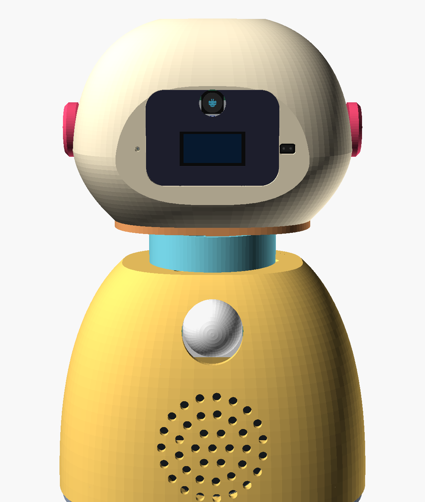
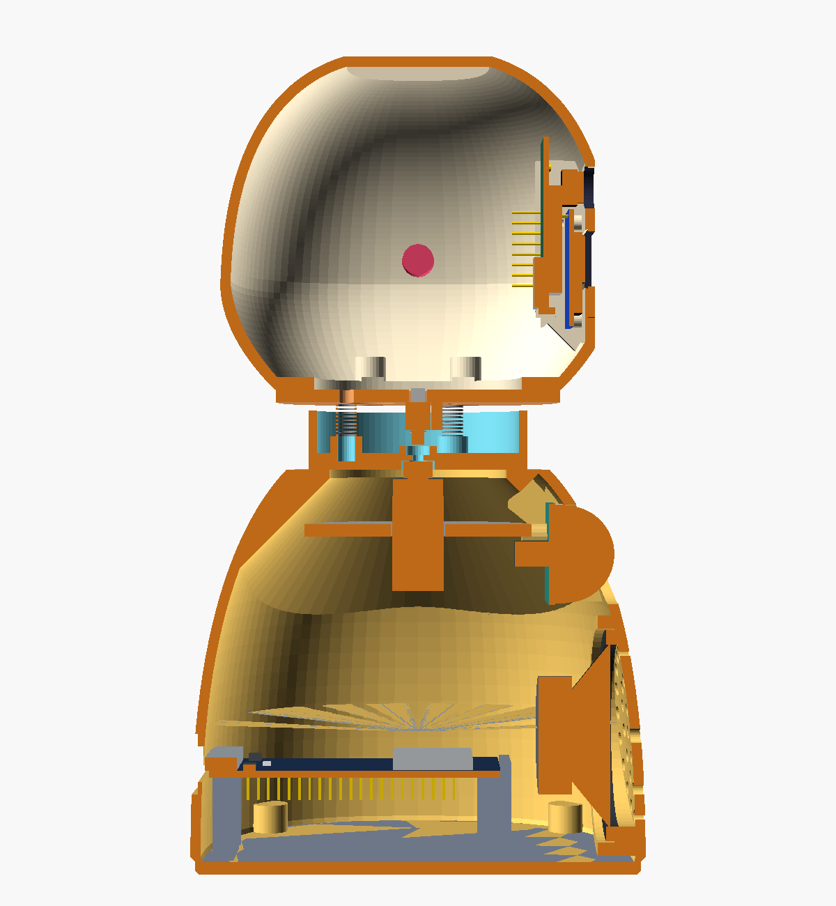

# Kids Robot — versión "redondo" v1

Cuerpo de gomita, cuello que gira con el servo y una **cabeza que es un botón
gigante**: al apretarla en cualquier parte baja 2 mm sobre 3 resortes y aprieta
un microswitch. Reemplaza al sensor táctil TTP223. Lleva espacio para todo lo
comprado: ESP32-S3, OLED, micrófono, amplificador, parlante, servo, **cámara
ESP32-CAM, PIR y sensor de distancia IR (VL53L0X)**.

> **Estado:** CAD v1 revisado en OpenSCAD (vistas y cortes), **sin imprimir ni
> probar**. Las medidas de los módulos son típicas y varias dicen *MEDIR* en
> `parametros.scad`: mídelas con pie de metro antes de imprimir.



## Medidas

| Qué | mm |
|---|---|
| Ancho × fondo × alto total | 128 × 108 × 194 |
| Cuerpo (gomita) | 128 × 108 × 96 |
| Cabeza (burbuja con cara plana) | 112 × 94 × 79 |
| Cuello visible | disco Ø 52, 14 de alto |
| Recorrido del botón | 2 (tope firme en el tubo del cuello) |
| Giro de la cabeza | ±80° (sin anillo rozante: lazo de cable) |

## Dónde va cada cosa

| Pieza | Lugar | Cómo se sujeta |
|---|---|---|
| ESP32-S3 | sobre la base, USB-C hacia la ventana de atrás | cuna con tope + brida o elástico |
| MAX98357A + 470 µF | sobre la base, a la derecha | pedestal con cinta doble faz; anillo para el condensador |
| Parlante 50 mm | barriga (abajo al frente) | aro centrador + silicona por el borde |
| PIR HC-SR501 | pecho, la cúpula asoma ~4 mm | 2 tornillos M2 a los nervios |
| SG90 | cuelga del labio del cuello | soporte con 3 M3 desde arriba; tornillos propios en las orejas |
| Microswitch | bajo el piso de la cabeza, al centro | 2 M2 a la pestaña; un "dedo" fijo en el disco lo aprieta |
| OLED | cara, detrás de la ventana del visor | 4 M2 a torres cortas |
| ESP32-CAM | cabeza, detrás del OLED; lente por el visor | apoya en dos topes + repisa; punto de silicona |
| VL53L0X | cara, a un lado del visor | bolsillo en U + punto de silicona |
| INMP441 | cara, al otro lado del visor | bolsillo en U + espuma alrededor del agujero |

Los sensores son el **PIR HC-SR501** (movimiento, en el pecho) y el láser
**VL53L0X** (distancia, en la cara).

## Cómo funciona el botón



1. El **disco** gira con el servo y apoya en el labio del cuerpo (el servo no
   recibe la fuerza del apretón).
2. Sobre el disco hay 3 postes con inserto M3. El **piso de la cabeza** desliza
   sobre 3 tornillos M3 × 16 y lo empujan hacia arriba 3 **resortes de lápiz**.
   Las cabezas de los tornillos fijan la altura de reposo.
3. Al apretar, el piso baja hasta tocar el borde del tubo (tope a 2 mm). En el
   camino, el **dedo** del disco aprieta el rodillo del microswitch. Está al
   centro, así que funciona aunque aprieten en el borde de la cabeza.
4. Si no hace clic o queda apretado: ajusta el alto del dedo (`DEDO_H`) o la
   altura de reposo con los tornillos guía.

### Cableado del botón (sin cambiar el firmware)

El firmware lee GPIO 14 como "tocado = 1" (así funcionaba el TTP223). Con el
microswitch se cablea igual:

- COM → 3V3
- NO → GPIO 14
- **resistencia de 10 kΩ de GPIO 14 a GND** (cerca del ESP32)

### Cables por el cuello (todos van a la cabeza)

3V3, GND, SDA y SCL (OLED y VL53L0X comparten el I2C: 0x3C y 0x29), SCK, WS y
SD del micrófono, el botón y 5 V de la cámara. Son **9 hilos** (10 si se usa
XSHUT). Usa cable plano o Dupont trenzado y deja un lazo dentro del cuerpo.

## Pendientes antes de conectar

- **PIR:** su salida (3,3 V) necesita un GPIO libre. Propongo el **GPIO 7**
  (no está en la lista de evitar). Hay que confirmarlo y agregarlo al plan de
  pines.
- **Cámara:** es un nodo Wi-Fi aparte. Desde el cuerpo solo recibe 5 V y GND.
  Pon 470 µF en su entrada de 5 V. Su antena externa va pegada por dentro,
  atrás en la cabeza.
- **Alimentación:** servo, parlante, cámara y S3 comen todos del USB. Usa un
  cargador de 5 V y 2 A con un buen cable.

## Piezas impresas

| Pieza | Cant. | Orientación (el STL ya viene así) | Soportes |
|---|---:|---|---|
| prueba | 1 | plana | no. **Imprimir primero** (insertos 4,0 / 4,2 / 4,4) |
| cuerpo | 1 | de pie, abierto abajo | no (paredes ≤ 48°, labio con cono de 45°) |
| base | 1 | plana | no |
| soporte_servo | 1 | placa abajo | no |
| disco | 1 | disco abajo | no |
| piso | 1 | boca abajo (pestaña del switch hacia arriba) | no |
| cabeza | 1 | de pie, abierta abajo | **sí, en árbol, solo desde la cama** (el techo de la cúpula) |
| visor | 1 | cara exterior abajo, en negro | no |
| oreja | 2 | cara exterior abajo, perno arriba | no |

PLA+ o PETG, boquilla 0,4, capa 0,2, 6 perímetros en cuerpo y cabeza (pared de
2,4), 15–20 % giroide. Colores sugeridos: cuerpo amarillo, cabeza crema, visor
negro, orejas y piso de otro color.

## Ferretería

- 14 insertos M3 de calor y tornillos M3: 4 × 8 (base), 3 × 10 avellanados
  (labio), 3 × 16 (guías del botón), 4 × 8 avellanados (cabeza).
- Tornillos M2 × 6: 4 para el OLED, 2 para el PIR y 2 × 10 con tuerca para el
  microswitch.
- 3 resortes de lápiz (Ø ~5 mm, largo libre 10–15 mm), 1 resistencia de 10 kΩ,
  4 patas de goma de 10 mm, cinta doble faz de espuma y silicona caliente.
- Cable de 10 hilos (~25 cm) para el cuello.

## Armado (resumen)

1. Imprime `prueba` y ajusta `INS_D` si el inserto entra flojo o duro.
2. Centra el servo (90°) y atorníllalo al soporte por las orejas. Sube el
   soporte por abajo del cuerpo y fíjalo con 3 M3 desde arriba del labio.
3. Calza el brazo doble del servo en el rebaje del disco. El tornillo central
   pasa por el agujero del dedo.
4. Pega el parlante en el aro de la barriga y atornilla el PIR a los nervios.
5. En la base: ESP32 en la cuna, amplificador en el pedestal y condensador en
   su anillo. Conecta, mete la base por abajo y atorníllala.
6. Cabeza: OLED con 4 M2, cámara contra sus topes, VL53L0X y micrófono en sus
   bolsillos. Microswitch al piso. Pasa los 9 hilos por el piso y el disco.
7. Pon los resortes en los postes, el piso encima y los 3 tornillos guía.
   Ajusta hasta que el botón haga clic antes del tope.
8. Calza la cáscara de la cabeza sobre el piso: 4 M3 desde abajo. Pega el
   visor y las orejas.

## Archivos

```
redondo/
├── robot.scad          piezas, ensamble y cortes (PARTE = ...)
├── componentes.scad    modelos de los módulos (ESP32-S3, OLED, cámara, etc.)
├── parametros.scad     todas las medidas; las MEDIR hay que comprobarlas
├── exportar_stl.py/.bat exporta las piezas a stl/
├── stl/                (se genera con exportar_stl; no está en el repo)
├── vistas/             renders: frente, ensamble, corte, cortes de la cabeza, componentes
└── planos/boceto.py/.svg boceto acotado (frente, corte y el botón)
```

Vistas útiles: `PARTE="corte"` (corte central), `"corte_x"` con `CORTE_X=-28`
(corte por el VL53L0X), `"apretado"` (cabeza apretada) y `"componentes"`.
Para exportar se necesita OpenSCAD: `winget install OpenSCAD.OpenSCAD`.
